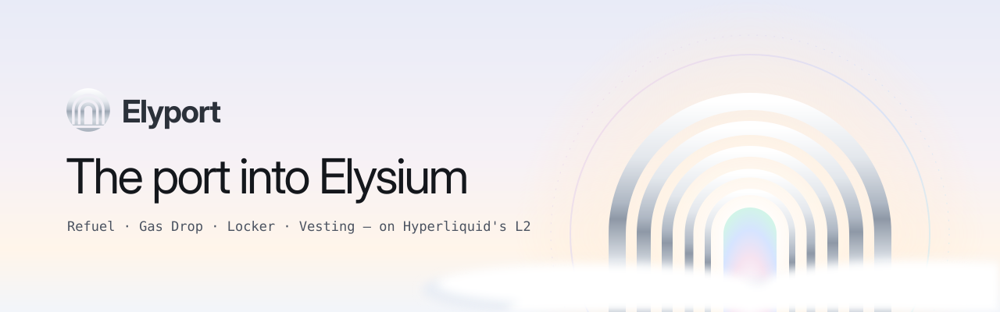
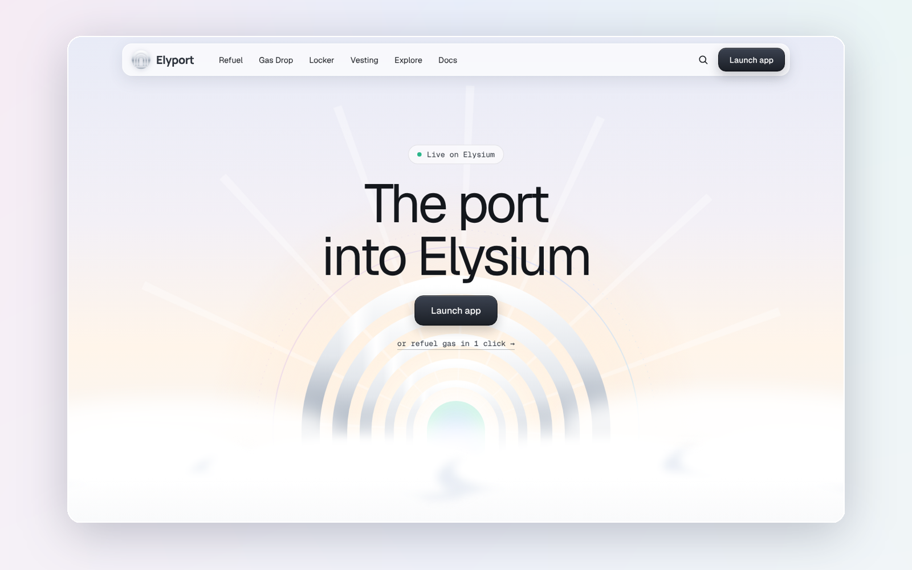
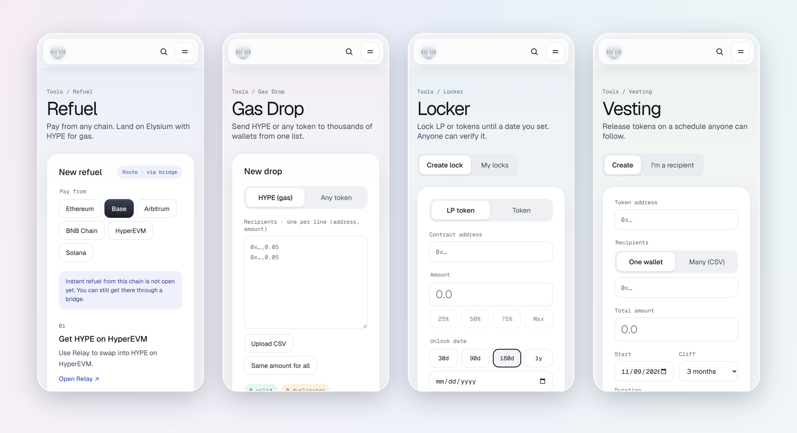
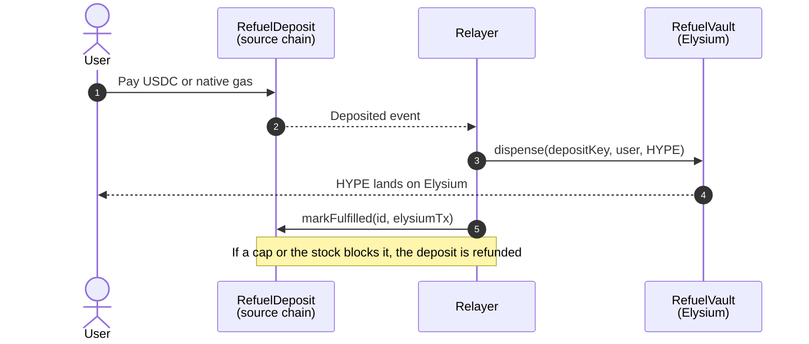

<p align="center">
  
</p>

<h3 align="center">The port into Elysium</h3>

<p align="center">
  Gas from any chain, airdrops to thousands, and locks and vesting that traders can verify,<br>
  all in one place on Elysium, the Hyperliquid L2.
</p>

<p align="center">
  <a href="https://elyport.com"><b>Open the app</b></a> ·
  <a href="https://elyport.com/docs">Docs</a> ·
  <a href="#contracts">Contracts</a> ·
  <a href="#run-it-locally">Run locally</a>
</p>

<p align="center">
  <a href="https://github.com/ElyportHQ/Elyport/actions/workflows/ci.yml"></a>
  
  
  
  
</p>

<p align="center">
  
</p>

## What Elyport does

| Tool | For | What it does |
| --- | --- | --- |
| **Refuel** | Users | Get HYPE for gas on Elysium, paid from Ethereum, Base, Arbitrum, Robinhood Chain, BNB Chain, HyperEVM or Solana |
| **Gas Drop** | Builders | Send HYPE or any token to up to 500 wallets per batch, from a list or CSV |
| **Locker** | Builders | Lock LP and tokens until a set date, or in up to 20 tranches. Extend or top up, never shorten |
| **Vesting** | Builders | Cliff plus linear or monthly release, for one wallet or a whole CSV |
| **Token safety** | Traders | See how much of a token's LP and supply is locked or vesting before buying |
| **Claim page** | Builders | One shareable link per token where recipients connect and claim: `elyport.com/claim/<token>` |
| **My Elyport** | Everyone | Your locks, vesting and drops in one place, with Claim, Claim all and Withdraw |
| **Lock badge** | Builders | A live "Liquidity locked" badge for your site or README at `elyport.com/badge/<token>` |

<p align="center">
  
</p>

## How Instant Refuel works



The app asks the relayer to deliver as soon as the payment confirms, and scheduled sweeps catch anything missed.
Every deposit has a unique key, so the vault can never pay the same deposit twice.
Instant refuels are capped per transaction, per wallet per day and per day. Larger amounts go through a bridge route.

## Contracts

| Contract | Chain | What it does |
| --- | --- | --- |
| `ElyportLocker` | Elysium | Time-locks LP and tokens. Public and indexed by token and owner |
| `ElyportVesting` | Elysium | Cliff and linear or periodic vesting, single or batch, optionally revocable |
| `ElyportDrop` | Elysium | Multisend HYPE or any ERC-20. Failed native sends are refunded |
| `ElyportRefuelVault` | Elysium | Holds the HYPE stock. Relayer-only payouts with caps and pause |
| `ElyportRefuelDeposit` | Source chains | Takes USDC or native payments. Refundable until fulfilled |

### Mainnet addresses

| Contract | Chain | Address |
| --- | --- | --- |
| `ElyportLocker` | Elysium | [`0x7868e66c72df8dd0827f93e3674e53f72f8939cc`](https://elysium.kinetiq.xyz/explorer/address/0x7868e66c72df8dd0827f93e3674e53f72f8939cc) |
| `ElyportVesting` | Elysium | [`0x739a2b5d9ea7647ecc2de63c67ed04fe4a432c3e`](https://elysium.kinetiq.xyz/explorer/address/0x739a2b5d9ea7647ecc2de63c67ed04fe4a432c3e) |
| `ElyportDrop` | Elysium | [`0x7ba7b360771b23277991f29488afe8827d2bce33`](https://elysium.kinetiq.xyz/explorer/address/0x7ba7b360771b23277991f29488afe8827d2bce33) |
| `ElyportRefuelVault` | Elysium | [`0xa43e860ec638b039cb926e98590852c2fdcbcf65`](https://elysium.kinetiq.xyz/explorer/address/0xa43e860ec638b039cb926e98590852c2fdcbcf65) |
| `ElyportRefuelDeposit` | Ethereum, Base, Arbitrum, Robinhood Chain, BNB Chain | `0xc051f16eab3b7c2a74fabc4dd0acfa5b5d5f4c39` |
| `ElyportRefuelDeposit` | HyperEVM | `0x739a2b5d9ea7647ecc2de63c67ed04fe4a432c3e` |

Locker, Vesting and Drop are v2 (holder discounts, batch locks). The v1 versions were never used and are retired.

Built on OpenZeppelin v5 (`Ownable2Step`, `ReentrancyGuard`, `Pausable`, `SafeERC20`). Fees are flat amounts in HYPE, forwarded straight to the fee recipient.

| Action | Fee |
| --- | --- |
| Refuel | 0.5% |
| Lock | about $10 in HYPE |
| Vesting | about $10 in HYPE per create |
| Gas Drop | about $3 in HYPE per batch |

## Repository

```
contracts/   Foundry project: src, tests, deploy scripts
web/         Next.js app: home, tool consoles, public lock, vesting and token pages, docs, refuel relayer
.github/     CI for contracts and web
```

## Run it locally

**Contracts**

```bash
cd contracts
forge install foundry-rs/forge-std@v1.9.4 --no-git
forge install OpenZeppelin/openzeppelin-contracts@v5.1.0 --no-git
forge test
```

**Web**

```bash
cd web
cp .env.example .env.local   # fill in contract addresses and the Reown project ID
npm install
npm run dev
```

Full launch checklist: **[DEPLOY.md](DEPLOY.md)**. Security reports: **[SECURITY.md](SECURITY.md)**.

<details>
<summary><b>Deploying (short version)</b></summary>

<br>

**Elysium side**

```bash
OWNER=0x… FEE_RECIPIENT=0x… RELAYER=0x… LOCK_FEE_WEI=… VESTING_FEE_WEI=… DROP_FEE_WEI=… \
VAULT_MAX_PER_TX_WEI=… VAULT_MAX_PER_WALLET_DAY_WEI=… VAULT_MAX_PER_DAY_WEI=… \
forge script script/Deploy.s.sol:DeployElysium --rpc-url $ELYSIUM_RPC_URL --broadcast --private-key $DEPLOYER_KEY
```

**Each source chain**

```bash
OWNER=0x… RELAYER=0x… USDC=0x… USDC_MIN=1000000 USDC_MAX=10000000 NATIVE_MIN_WEI=… NATIVE_MAX_WEI=… \
forge script script/Deploy.s.sol:DeploySource --rpc-url $SOURCE_RPC_URL --broadcast --private-key $DEPLOYER_KEY
```

**Web on Vercel**

Set **Root Directory** to `web`. The refuel relayer runs at `/api/relayer`, called by Vercel Cron (`vercel.json`)
and protected by `CRON_SECRET`. The relayer wallet needs HYPE on Elysium and native gas on every source chain.

</details>

## License

- **App and tooling** (`web/`, workflows, docs): [Business Source License 1.1](LICENSE). Free to read, audit, run and test;
  running a competing hosted service is not allowed. Converts to GPL-2.0-or-later on 2030-11-10.
- **Smart contracts** (`contracts/`): [MIT](contracts/LICENSE), the same source that is verified on-chain.

## Principles

- **Verifiable by default.** Every lock and schedule has a public page anyone can check.
- **Capped and careful.** Instant refuels have hard limits and can be paused.
- **No token required.** Fees are paid in HYPE.

---

<p align="center">
  <br>
  <sub>Elyport is an independent tool. Not affiliated with Kinetiq or Elysium.</sub>
</p>
